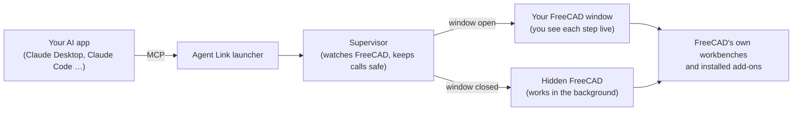
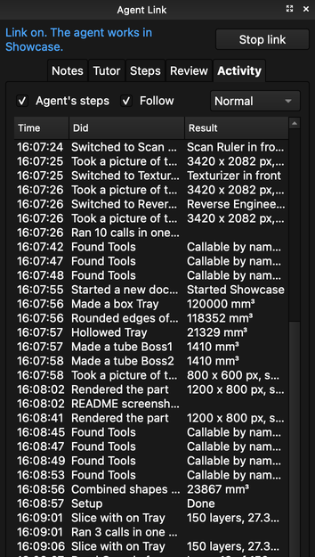
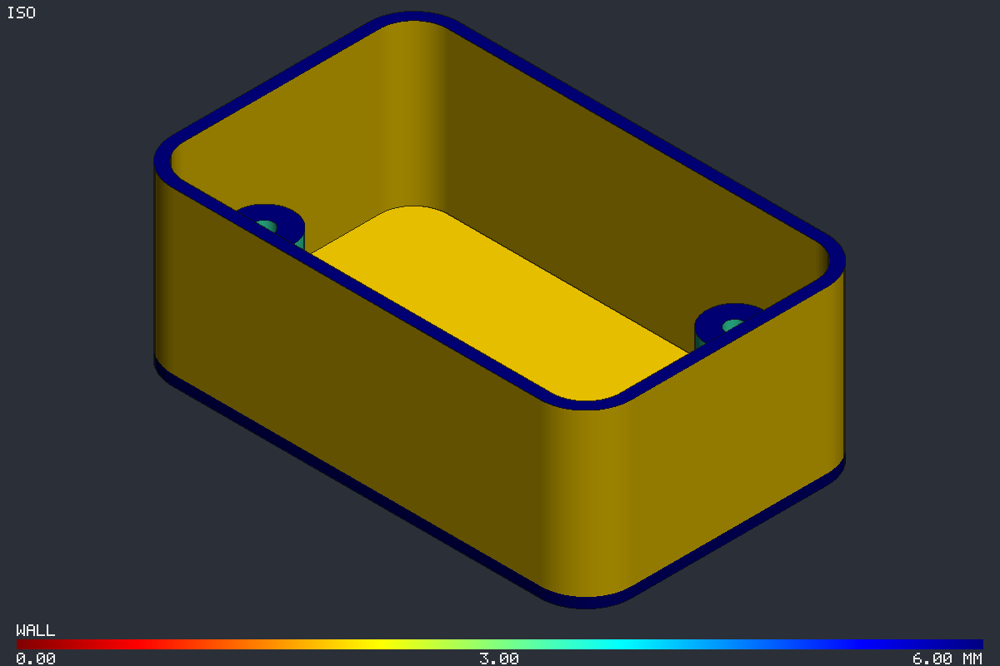
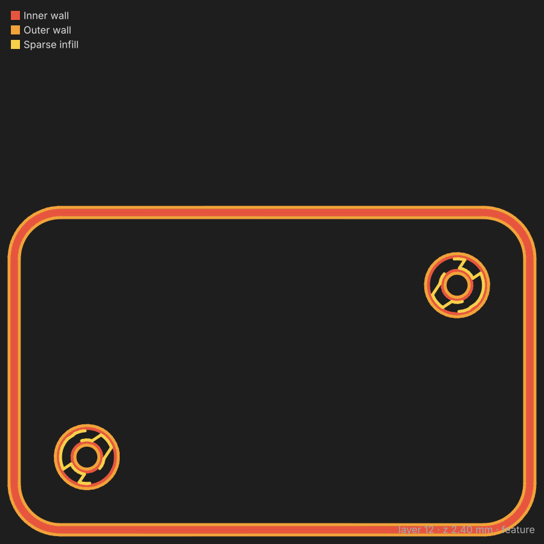
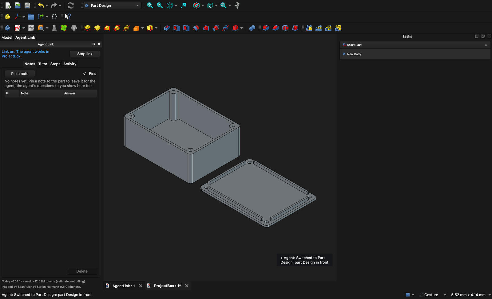
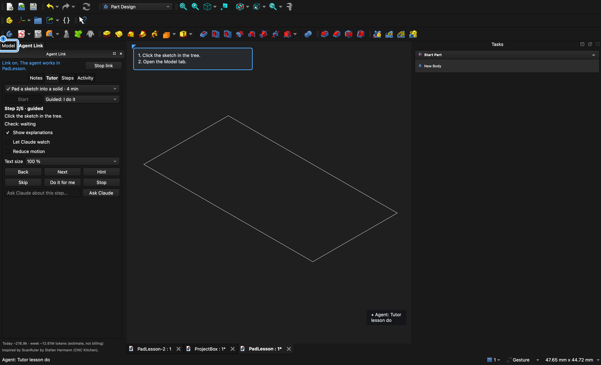
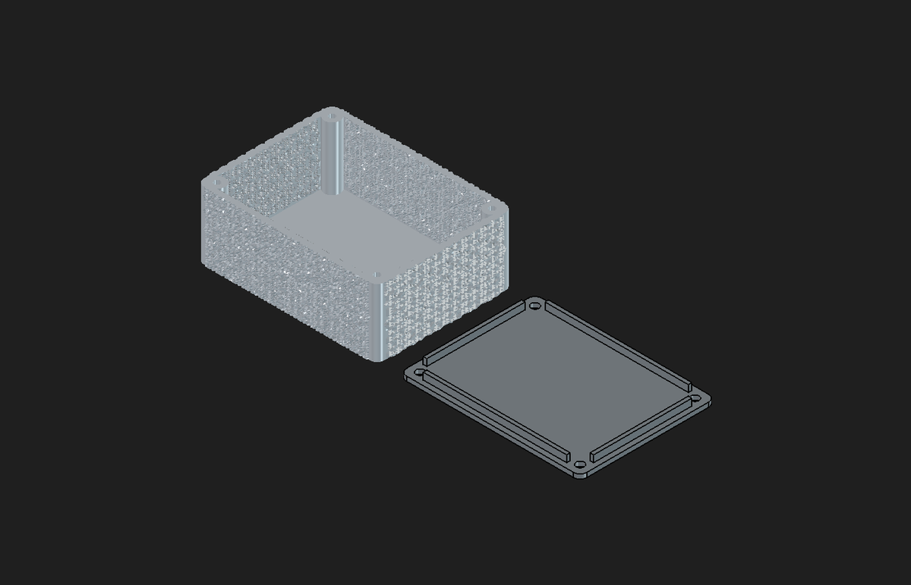

<!-- SPDX-License-Identifier: LGPL-2.1-or-later -->
<!-- mcp-name: io.github.jamesK1000011/agentlink-freecad -->
# Agent Link for FreeCAD

> Not affiliated with or endorsed by the FreeCAD project or the FreeCAD project association (FPA); FreeCAD is the FPA's trademark. Get FreeCAD itself from [freecad.org](https://freecad.org).

- [What it is](#what-it-is)
- [What you need](#what-you-need)
- [Install](#install)
- [Connect your agent](#connect-your-agent)
- [First steps](#first-steps)
- [Approvals](#approvals)
- [Where everything lives](#where-everything-lives)
- [Screenshots](#screenshots)
- [What the agent can do](#what-the-agent-can-do)
- [Add-ons](#add-ons)
- [Platforms](#platforms)
- [Token usage](#token-usage)
- [Privacy](#privacy)
- [Troubleshooting](#troubleshooting)
- [Uninstall](#uninstall)
- [Tests](#tests)
- [Credits and licence](#credits-and-licence)

For an agent that sets this up: follow [SETUP.md](https://github.com/jamesK1000011/AgentLink-FreeCAD/blob/main/SETUP.md).

How it works inside, with diagrams: [docs/workflow/](https://github.com/jamesK1000011/AgentLink-FreeCAD/blob/main/docs/workflow/README.md).

## What it is

Agent Link lets an AI agent use FreeCAD for you. You need no CAD skills.
You tell the agent what you want: an idea, some measurements, a photo or a 3D scan.
The agent makes the part, checks it, draws it and exports the files.
You can watch each step in your own FreeCAD window.
It works in the background: it does not take your mouse or keyboard, and it does not fill your screen.
Each change is one FreeCAD undo step.

Strength checks (FEA, finite element analysis) and the other checks tell you if a design is feasible.
They are never a sign-off: an engineer must approve a part where safety is important.

Some words used here:

- **Agent**: the AI that does the work, for example Claude.
- **MCP** (Model Context Protocol): the standard way an agent uses a program. Agent Link is an MCP server.
- **MCP client**: the app that you talk to the agent in, for example Claude Desktop or Claude Code.
- **Headless**: FreeCAD runs with no window. The agent works, but you see nothing on screen.
- **Add-on**: an extra part for FreeCAD that adds tools. Agent Link is an add-on, and other add-ons add tools to it.
- **Hub**: Agent Link itself. It connects the agent to FreeCAD. The other add-ons ([Add-ons](#add-ons)) give the agent their tools through it.
  Tutor needs the hub. Workshop, ScanRuler for FreeCAD and Texturizer also work alone in FreeCAD, with no agent.

## How it works



- Your AI app sends each request to Agent Link through MCP (the Model Context Protocol).
- The supervisor sends it to your FreeCAD window when it is open, or to a hidden FreeCAD when it is not.
- The tool does the work with FreeCAD's own commands. In the window, you see the workbench change, the button light and the result selected. Your mouse and keyboard stay yours.
- File actions and code runs stop and ask you first (see [Approvals](#approvals)).
- The full path of one call, with the parts named: [docs/workflow/call-flow.md](https://github.com/jamesK1000011/AgentLink-FreeCAD/blob/main/docs/workflow/call-flow.md).
- What goes over the wire in one session, step by step, with the token cost of each step: [docs/workflow/session.md](https://github.com/jamesK1000011/AgentLink-FreeCAD/blob/main/docs/workflow/session.md).

### Tested on

- Every lesson that Tutor ships runs to the end in demo mode in a real FreeCAD 1.1.3 window on a Mac.
- All the add-ons installed together pass their tests on FreeCAD 1.1 and 1.0 (the bake-off in CI).
- A laser-cut plate with holes: nested on a sheet with FreeCAD's BIM Nest, offset by the kerf, written as DXF and SVG and read back.
- A STEP export read back with the same volume; an expression typed into a task panel field ("=2*3") kept by the feature.
- What the tool list costs in tokens, and how much of FreeCAD is covered: see [the numbers](#what-the-agent-can-do) below (made by `scripts/stats.py`, never typed by hand).

## What you need

- **FreeCAD 1.1 or later.** Get it from [freecad.org/downloads](https://www.freecad.org/downloads.php).
  On a Mac, drag it into Applications.
  **Open FreeCAD once, then close it.** This makes the folder that add-ons go into.
- **An MCP client.** Claude Desktop is the easiest on a Mac. Claude Code, Cursor, VS Code, LM Studio and others also work.
- **A computer.** macOS is fully supported. Linux is tested. Windows is expected to work but is not tested ([Platforms](#platforms)).
- **uv** (not needed for the Claude Desktop extension). uv is a small tool that starts Agent Link for the other clients. It brings its own Python.

| | macOS | Linux | Windows |
|---|---|---|---|
| **FreeCAD 1.1 or later** (required) | [freecad.org/downloads](https://www.freecad.org/downloads.php), dragged into Applications | the AppImage, your distribution's package, or conda-forge's `freecad` | the installer from freecad.org |
| **uv** (preferred: it brings its own Python) | `curl -LsSf https://astral.sh/uv/install.sh \| sh` or `brew install uv` | `curl -LsSf https://astral.sh/uv/install.sh \| sh` | `powershell -ExecutionPolicy ByPass -c "irm https://astral.sh/uv/install.ps1 \| iex"` |
| **Node** (not needed) | the Claude Desktop extension uses the Node that comes with Claude Desktop | not used | not used |
| OrcaSlicer (optional, slicing for 3D printing) | [releases](https://github.com/OrcaSlicer/OrcaSlicer/releases) | AppImage or Flatpak | installer |
| KiCad (optional, circuit boards) | [kicad.org](https://www.kicad.org/download/) | your package manager | installer |
| Gmsh, CalculiX (optional, strength checks) | come with FreeCAD | your package manager, or with FreeCAD | come with FreeCAD |

Agent Link runs in FreeCAD's own Python. You do not install Python libraries by hand.
Without uv, a client can start Agent Link with FreeCAD's own Python ([Without uv](https://github.com/jamesK1000011/AgentLink-FreeCAD/blob/main/docs/clients/README.md#without-uv)).

**The setup check** tells you what is missing and how to get it. It changes nothing. Run it in a terminal:

```
uvx --from git+https://github.com/jamesK1000011/AgentLink-FreeCAD agentlink-freecad --check
```

From a copy of this folder, `python3 agentlink_headless.py --check` does the same.
In FreeCAD, **Agent Link > Setup Check** does the same for the Claude extension.

## Install

Pick the part for your MCP client. Each one gives the agent the FreeCAD tools.
To watch the agent in your window, FreeCAD also needs the Agent Link add-on.
The Claude Desktop extension installs it for you. For the other clients, use the Addon Manager or the "By hand" steps.

### Claude Desktop on a Mac: the extension (easiest)

1. Install FreeCAD and open it once ([What you need](#what-you-need)).
2. Download [`freecad-agentlink.mcpb`](https://github.com/jamesK1000011/AgentLink-FreeCAD/releases/latest/download/freecad-agentlink.mcpb).
   It is attached to the newest `agentlink-v…` [release of this repository](https://github.com/jamesK1000011/AgentLink-FreeCAD/releases).
3. Double-click the file. Claude Desktop opens and asks you to install it. Click **Install**.
4. Start a new chat in Claude Desktop.

The extension finds FreeCAD in Applications.
It installs Agent Link and the add-ons that come with it into FreeCAD, and keeps them up to date:
Workshop for FreeCAD, ScanRuler for FreeCAD (ported from ScanRuler by Stefan Hermann, CNC Kitchen),
Texturizer (BumpMesh's textures, also by Stefan Hermann, CNC Kitchen), Tutor and Agent Link for OrcaSlicer.

The extension has three settings:

- **Output folder**: where exports, drawings and pictures go (`~/AgentLink` by default).
- **FreeCAD app**: only if FreeCAD is not in Applications.
- **Keep the add-ons up to date**: on by default.

The extension is built in this repository (`packaging/`, see [docs/packaging.md](https://github.com/jamesK1000011/AgentLink-FreeCAD/blob/main/docs/packaging.md)).
The copies once released from ScanRuler's `freecad-spike` branch are retired. An installed one moves to this repository at its next update.

### Claude Desktop with a config file (Windows, or a Mac without the extension)

1. Install uv ([What you need](#what-you-need)).
2. In Claude Desktop, open **Settings > Developer > Edit Config**. This opens `claude_desktop_config.json`.
3. Add this entry. If the file has other servers, add only the `agentlink-freecad` entry to `mcpServers`.

   ```json
   {
     "mcpServers": {
       "agentlink-freecad": {
         "command": "uvx",
         "args": ["--from", "git+https://github.com/jamesK1000011/AgentLink-FreeCAD", "agentlink-freecad"]
       }
     }
   }
   ```

4. Quit Claude Desktop and open it again.
5. Install the add-on in FreeCAD to watch the agent ([Addon Manager](#freecads-addon-manager)).

More: [docs/clients/claude-desktop.md](https://github.com/jamesK1000011/AgentLink-FreeCAD/blob/main/docs/clients/claude-desktop.md).

### Claude Code

1. Install uv ([What you need](#what-you-need)).
2. Run this in a terminal. It adds Agent Link for all your projects:

   ```
   claude mcp add -s user agentlink-freecad -- uvx --from git+https://github.com/jamesK1000011/AgentLink-FreeCAD agentlink-freecad
   ```

3. Run `claude mcp list`. It shows if Agent Link connected. In a session, `/mcp` shows its tools.

More (one project only, with `.mcp.json`): [docs/clients/claude-code.md](https://github.com/jamesK1000011/AgentLink-FreeCAD/blob/main/docs/clients/claude-code.md).

### Other MCP clients

Each client starts the same command:

```
uvx --from git+https://github.com/jamesK1000011/AgentLink-FreeCAD agentlink-freecad
```

Copy-paste settings for each client:
[Cursor](https://github.com/jamesK1000011/AgentLink-FreeCAD/blob/main/docs/clients/cursor.md),
[VS Code](https://github.com/jamesK1000011/AgentLink-FreeCAD/blob/main/docs/clients/vscode.md),
[LM Studio](https://github.com/jamesK1000011/AgentLink-FreeCAD/blob/main/docs/clients/lm-studio.md),
[OpenCode with Ollama](https://github.com/jamesK1000011/AgentLink-FreeCAD/blob/main/docs/clients/opencode-ollama.md) and
[any other MCP client](https://github.com/jamesK1000011/AgentLink-FreeCAD/blob/main/docs/clients/generic.md).
All of them: [docs/clients/](https://github.com/jamesK1000011/AgentLink-FreeCAD/blob/main/docs/clients/README.md).

ChatGPT needs a remote server, so it is out of scope ([why](https://github.com/jamesK1000011/AgentLink-FreeCAD/blob/main/docs/clients/README.md#chatgpt)).
A small local model works best with the short tool list ([small local models](https://github.com/jamesK1000011/AgentLink-FreeCAD/blob/main/docs/clients/README.md#small-local-models)).

### FreeCAD's Addon Manager

Use this to install the add-on into FreeCAD when you do not use the Claude Desktop extension.

1. In FreeCAD, open **Edit > Preferences > Addon Manager**.
2. Under *Custom repositories*, add `https://github.com/jamesK1000011/AgentLink-FreeCAD` with branch `main`.
3. Open **Tools > Addon manager**. Find **Agent Link**. Click **Install**.
4. Restart FreeCAD.
5. Connect your agent with one of the client parts above.

The Addon Manager puts the add-on in the `Mod` folder as `AgentLink-FreeCAD`.

### By hand

Put this folder in FreeCAD's `Mod` folder as `AgentLink`.
The setup check (`--check`) prints where the folder is.
In FreeCAD's Python console, `FreeCAD.getUserAppDataDir()` also gives it (the `Mod` folder is inside it).

```
git clone https://github.com/jamesK1000011/AgentLink-FreeCAD "<FreeCAD user folder>/Mod/AgentLink"
```

Restart FreeCAD.
For headless use only (no window), you need no install in FreeCAD. The `uvx` command starts it.

## Connect your agent

Every client starts the same command:

```
uvx --from git+https://github.com/jamesK1000011/AgentLink-FreeCAD agentlink-freecad
```

It finds FreeCAD, runs in FreeCAD's own Python, and writes files to `~/AgentLink`.
Add `--out DIR` for another folder.

**To watch the agent work:** open FreeCAD (with the add-on installed).
The link starts by itself when the window opens.
The calls then go to the document open in your window.
When the link is off, the calls run headless.
To turn the link on or off, pick the **Agent Link** workbench and press **Start Link** or **Stop Link**.
The link listens on 127.0.0.1 only (your own computer). It pairs with the server before it takes a call.

## First steps

Start a new chat in your client. Try these prompts, one at a time.

1. "Make a box 60 by 40 by 20 mm, with 2 mm walls and an open top. Show me a picture."

   In the FreeCAD window, the workbench changes, a sketch opens, and the box is made step by step.
   In the chat, the agent shows a picture of the box. The Agent Link panel's *Activity* tab lists each step.

2. "Is the box one sound solid? What does it weigh in PETG?"

   The agent checks the body, sets the material and measures the mass. It tells you the result in grams.

3. "Export the box as STEP and STL."

   The agent writes the two files to `~/AgentLink` (or the output folder you chose) and tells you where they are.

To undo a change, say "undo that". Each change is one undo step.

## Approvals

Some steps need your approval. Two small tools ask for it:

- **`approve_code`**: before the agent runs or installs code. For example, a macro, a cookbook, an add-on install or update, or an extension.
- **`approve_file`**: before the agent acts on your files. For example, a press on Save, Don't Save or Replace in a file dialog, a recovered copy saved over your file, or "save all" at a restart.

You set each tool in your client's tool permissions. The agent cannot approve alone when the tool is set to ask first.

- **Claude Desktop**: in the tool settings of Agent Link, set `approve_code` and `approve_file` to **Ask first** (the other choices are *Always allow* and *Block*).
- **Claude Code**: Claude Code asks before each MCP tool by default. Do not add these two tools to your allowed tools.
- **Other clients**: use the client's tool permissions. Set the two tools to ask you each time.

"Ask first" is the safe setting. "Always allow" lets the agent approve alone, for example for headless use. That is your choice.
How it works inside: [docs/workflow/approvals.md](https://github.com/jamesK1000011/AgentLink-FreeCAD/blob/main/docs/workflow/approvals.md).

## Where everything lives

- **The workbench**: pick *Agent Link* from FreeCAD's workbench list.
- **The toolbar**: *Start Link*, *Stop Link*, *Agent Link panel*, and
  *Screenshot for Agent* (Alt+Shift+S: take a picture of the window, mark it up, leave it for the agent).
- **The Agent Link menu**: the same, plus *Setup Check* and *Updates* (which Agent Link this is and how it is kept up to date).
- **The panel**, beside the model tree, in tabs:
  - *Notes*: notes pinned to the parts, between you and the agent; the agent's questions to you;
  - *Steps*: the build played back step by step, one picture for each step;
  - *Review*: the part's review, from a reviewer add-on when one is installed;
  - *Activity*: each thing the agent does in this window, as it occurs;
  - the tabs of installed add-ons;
  - the usage strip along the bottom ([Token usage](#token-usage)).
- **The files**: exports, drawings and pictures go to `~/AgentLink` (or the folder you chose).

## Screenshots

<!-- screenshots: still to take: Claude Desktop extension settings (not taken: it shows the account); the Addon Manager preferences with the custom repository -->


*The Agent Link workbench and its toolbar.*



*The Activity tab: each step the agent took, with its result, as it happens.*



*A wall-thickness map from view_render (red is thin). It works headless too.*



*The same tray sliced by OrcaSlicer through Agent Link, and one layer read back from the G-code.*



*A project box and lid made in one call (Workshop's `gen_part`). The Agent Link panel shows the link, the notes and the token meter.*



*A Tutor lesson, guided: the callout says what to do, a numbered ring points at the control, and the step is checked against the document.*



*The same box with a knurled texture on its walls (Texturizer: BumpMesh by Stefan Hermann, CNC Kitchen).*

## What the agent can do

<!-- tools:begin (scripts/tool_summary.py) -->
Agent Link itself declares 421 tools in 33 groups; a FreeCAD build without a workbench (FEM, CAM …)
serves fewer, and each installed add-on adds its own groups.
By default the client lists only six tools; the agent finds any other tool with `tool_find` and calls it by name.
With `AGENTLINK_TOOLLIST=classic`, groups marked *lean* are listed from the start, and the agent turns on the rest with `tool_groups`.

| Group | Tools | What it holds |
|---|---:|---|
| `core` *lean* | 21 | The session, groups, guides, batches, jobs (long reads), undo, soundness, export. Always listed in the classic tool list. |
| `find` | 2 | tool_find: any tool by plain words, its card, the groups; tool_find is listed in the static base (ToolListMode static). pick: run one of the numbered options that session_state and changing answers give. |
| `app` | 18 | FreeCAD itself: settings (any parameter, preference packs), commands and menus run by name in the window, workbenches. |
| `doc` | 12 | The document: new, open, save; objects listed, read, set, renamed, deleted; recompute; import and export files. |
| `model` | 27 | Part modelling: primitives, booleans, move/rotate/mirror/scale/arrays, fillets and chamfers, offset and shell, extrude, revolve, loft, sweep. |
| `measure` | 6 | Find faces and edges (the references other tools take), measure between them, sections, mass properties, clearance. |
| `sketch` | 20 | PartDesign bodies and sketches: geometry, constraints, the solver's reading (DoF, conflicts, closed wires) and edits. |
| `feature` | 27 | PartDesign features (pad, pocket, revolve, hole, fillet, chamfer, draft, shell, patterns, loft, pipe, datum planes) and the body's feature history. |
| `param` | 6 | Named parameters in a Params spreadsheet, and properties or named sketch constraints bound to expressions over them. |
| `sheet` | 12 | Spreadsheets: any cell read and written (values, expressions, aliases, units), formatting, rows and columns, CSV import and export, and design tables (configurations) that drive a part. |
| `material` | 4 | Materials: search FreeCAD's library and the printing filaments, read a card's figures, set what each body is made of. |
| `strength` | 16 | Strength by finite elements (Gmsh and CalculiX): set up a body, hold faces, load them, solve for stress, displacement and safety factor. |
| `techdraw` | 32 | TechDraw pages piece by piece: template and title block, views, projection groups, sections, details, dimensions on real edges with tolerances and fits, GD&T frames, datums, notes, balloons, tables, export to SVG, PDF and DXF. |
| `inspection` | 6 | FreeCAD's Inspection: an actual (mesh, points, body or scan file) against nominals, point by point, with tolerance, statistics, worst spots, a colour map and a report. |
| `view` *lean* | 3 | Pictures: the parts drawn from any view, cut open, zoomed, with maps (wall, stress, a scan's deviation) — headless; the FreeCAD window's own view. |
| `notes` | 7 | Notes pinned to the parts between the person and the agent; the build played back step by step, a picture a step (inspired by Stefan Hermann's ScanRuler, CNC Kitchen). |
| `mesh` | 21 | FreeCAD's Mesh workbench on document meshes: mesh a body, evaluate and repair, decimate, refine, smooth, offset, trim, transform, booleans, cross-sections, split, planar and curvature segments, curvature, projection onto a mesh. |
| `assembly` | 18 | Assemblies (FreeCAD's Assembly workbench): parts put together, one grounded, joints between faces and edges solved; positions, freedom left and overlaps checked. |
| `cam` | 12 | Toolpaths (FreeCAD's CAM workbench): a job with stock and end mill, profile, pocket, adaptive, facing and drilling operations, G-code posted and checked. |
| `draft` | 19 | Draft: lettering raised from or cut into a face from a TrueType font, SVG/DXF outlines, arrays, and Draft's own parametric 2D shapes, dimensions, labels, link arrays, clones, move/rotate/scale/mirror/offset, upgrade/downgrade, layers, hatches, Draft↔Sketch, 2D views, facebinders, heal. |
| `surface` | 11 | Surface workbench features (parametric): sections, boundary surfaces (stretched/Coons/curved), extend, sewing into shells and solids, surface cuts, blend curves; surfaces filled across edges, lofted through curves, fitted to points or a polynomial, thickened into solids. |
| `points` | 9 | Point clouds (Points, Reverse Engineering): read and write ASC/XYZ, PCD, PLY, E57, CSV; sample a body or mesh; crop and thin; fit a plane, sphere, cylinder or B-spline surface, and make it a body. |
| `bim` | 37 | BIM (Arch): walls, windows and doors in walls, columns, beams, slabs, roofs, stairs, spaces, levels, building and site, quantities, IFC in and out. |
| `openscad` | 6 | OpenSCAD: CSG and SCAD files in, OpenSCAD code run into the document, CSG out, hull and Minkowski sums. |
| `robot` | 7 | Robot: six-axis robots (KUKA models, your own kinematics), moves by axes or tool point, trajectories from waypoints or edges, reach checked along them, KUKA KRL out. |
| `std_more` | 22 | Links, App::Part, the dependency graph, freeze, units, point-pair alignment, duplicates, merge files, document info, revert, save all, appearance and face colours, text documents; compounds, join features; PartDesign clone, move feature, reorder, tip. |
| `cam_more` | 3 | CAM paths from areas and shapes, compound, array, stop, fixture offsets, property bags, job templates. |
| `bim_gaps` | 16 | BIM components, clones, references, structural systems, pipe connectors, panel cuts and sheets, nesting, IFC B-rep flag, 2D level views, image planes, library, re-extrude, rewire, glue, trash, reorder. |
| `fem_more` | 3 | FEM: every boundary condition, material, element, equation, solver and mesh refinement by kind; Netgen meshes, FEM mesh to mesh, mesh groups cleared; stress linearization. |
| `unattended` | 3 | Unattended use: the pinned document, the heavy-job queue, the Addon Manager (dialog_answer and app_force_restart are in core). |
| `dev` | 4 | For add-on developers: an installed add-on's own test suite run in a separate FreeCAD process (addon_test); live window scripts replayed and checked (live_run); mouse and keyboard input to the window's own widgets for GUI checks (gui_input), and closing a menu or dialog that holds the window (gui_unstick). |
| `porting` | 8 | Port an add-on to Agent Link: a draft port from its commands (port_scaffold), and cookbooks of its commands, functions and call lists, run after the person's OK. |
| `fast` | 3 | The fast path: run runs one step; fast runs many steps and gives one short answer; get reads one value with its unit. |
<!-- tools:end -->

Each group has a guide the agent reads (`guide_read`). Any tool runs by name, also when it is not listed.
To list every tool from the start, set `AGENTLINK_TOOLLIST=classic` and `AGENTLINK_TOOLS=full` (each alone does not do it).
Leave them unset for small local models
(see [docs/clients/](https://github.com/jamesK1000011/AgentLink-FreeCAD/blob/main/docs/clients/README.md#small-local-models)).

The table is generated: `python3 scripts/tool_summary.py` writes it again, and
`--check` (run by the tests) fails when it is out of date.

<!-- stats:begin (scripts/stats.py) -->
Release statistics for V1, made by `scripts/stats.py` from the data (all of them: [docs/stats/STATS.md](https://github.com/jamesK1000011/AgentLink-FreeCAD/blob/main/docs/stats/STATS.md)).

```
Per-tool status, all of V1 (measured: counted from the hardening records)
proven on a test model    ████████████████████ 613/622
  headless                ███████████████████░ 605/622
  live in the window      ████████████████████ 608/622
docs checked              ██████████████████░░ 554/622
health check seen         ███████████████░░░░░ 480/622
description rewritten     ██████████████████░░ 566/622

By section (tools proven / total)
Agent Link (core)         ████████████████████ 403/411
Workshop                  ████████████████████  59/59
ScanRuler for FreeCAD     ████████████████████ 132/133
Texturizer                ████████████████████  11/11
Tutor                     ████████████████████   3/3
Agent Link for OrcaSlicer ████████████████████   5/5

Developer tools (not counted): not in the totals above
proven on a test model    ░░░░░░░░░░░░░░░░░░░░   0/8
  headless                ░░░░░░░░░░░░░░░░░░░░   0/8
  live in the window      ░░░░░░░░░░░░░░░░░░░░   0/8
```

| Section | Tools | Proven | Headless | Live |
|---|---:|---:|---:|---:|
| Agent Link (core) | 411 | 403 | 396 | 403 |
| Workshop | 59 | 59 | 59 | 54 |
| ScanRuler for FreeCAD | 133 | 132 | 132 | 132 |
| Texturizer | 11 | 11 | 11 | 11 |
| Tutor | 3 | 3 | 2 | 3 |
| Agent Link for OrcaSlicer | 5 | 5 | 5 | 5 |
| **All of V1** | **622** | **613** | **605** | **608** |
| *Developer tools (not counted)* | *8* | *0* | *0* | *0* |

Known gaps: 9 tools are not proven, 8 more are proven live only and 5 more headless only. The main reasons: a program, a FreeCAD version or a printer that the test Mac does not have; a step that needs the person (a restart, an install, a go); or not tested yet. Each tool and its reason: [What is not covered, and why](https://github.com/jamesK1000011/AgentLink-FreeCAD/blob/main/docs/stats/STATS.md#what-is-not-covered-and-why). Not in V1 and not counted: 10 tools of private add-ons (Home-FreeCAD, agentlink-collab), cookbook format 2 and PrintLoop. In V1 but not counted: developer tools (8 tools: Porting), not FreeCAD functions.

Tools: 421 in Agent Link (core), 633 with all add-ons installed (`library_pack` in this count is callable but not listed).

Each token number is the estimated size of the `tools/list` answer: the tool names, descriptions and input schemas that the client loads into the agent's context at the start of a session. The server instructions, the guides and the tool answers are not in it. Estimate: 3.5 characters for each token.

| Tool list | Tools listed | Tokens (est.) of the `tools/list` answer |
|---|---:|---:|
| static (default), ste | 6 | 2,331 |
| static, full | 6 | 5,130 |
| classic, ste | 24 | 7,219 |
| classic, full | 24 | 9,947 |
<!-- stats:end -->

## Add-ons

Agent Link is a hub. Add-ons installed beside it bring their own tools, guides and panel tabs.
Agent Link finds them when FreeCAD starts. Each add-on has its own repository and licence.
An add-on that is not installed costs no tokens: its tools are never listed.
The Claude Desktop extension installs all of these.

- [Workshop for FreeCAD](https://github.com/jamesK1000011/Workshop-FreeCAD): standard parts, printing and cutting, electronics, documents, and SafetyNet checkpoints and recovery.
- [ScanRuler for FreeCAD](https://github.com/jamesK1000011/ScanRuler-FreeCAD): 3D scans and reverse engineering, ported from ScanRuler by Stefan Hermann (CNC Kitchen).
- [Texturizer for FreeCAD](https://github.com/jamesK1000011/Texturizer-FreeCAD): surface textures on parts, from BumpMesh by Stefan Hermann (CNC Kitchen).
- [Tutor for FreeCAD](https://github.com/jamesK1000011/Tutor-FreeCAD): lessons that teach FreeCAD in the panel.
- [Agent Link for OrcaSlicer](https://github.com/jamesK1000011/AgentLink-OrcaSlicer): slicing for 3D printing with your OrcaSlicer presets.

## Platforms

| | macOS | Linux | Windows |
|---|---|---|---|
| Core tools, headless and in the window | supported | CI-tested | expected to work, untested |
| Claude Desktop extension (`.mcpb`) | supported | Mac only | Mac only |
| Unattended features: a hidden FreeCAD kept running, restarts after a crash, app updates, harmless dialogs answered | supported | not yet | not yet |
| Launcher log and Setup Check's launcher report | supported | Mac only | Mac only |

Windows reports are welcome: open an issue that says what worked and what did not.

## Token usage

A token is the unit an AI provider counts and bills.
The panel's usage strip shows what the agent's calls cost in tokens: the tool list, each call and its answer, and pictures.
These are **estimates** from the text and image sizes. They are not your provider's bill.
The tool list starts short. Add-ons that are not installed cost nothing: their tools are never listed.
`usage_report` gives the agent the same figures. They are kept in `~/AgentLink/usage`.
`AGENTLINK_USAGE=off` turns the meter off.

## A run with a time limit

A runner that gives the agent a fixed time (a test run, a scheduled job) can tell Agent Link the limit.
Set `AGENTLINK_TIME_LIMIT_MIN` to the minutes in the server's `env`.
Agent Link reads it when it starts. The time counts from the agent's first tool call.
`session_state` then shows `time: N of M minutes used`, and from half the limit on, the health verdict of each changing answer ends with the same words.
When it is not set, nothing is shown.

## Privacy

Agent Link has no telemetry. It sends nothing anywhere on its own.
What the agent reads from FreeCAD (answers, pictures) goes to the AI provider of your MCP client, under that provider's terms.
Agent Link adds no other recipient.
The full privacy policy: [docs/PRIVACY.md](https://github.com/jamesK1000011/AgentLink-FreeCAD/blob/main/docs/PRIVACY.md).

- **The window link** listens on 127.0.0.1 only and pairs with the server before it takes a call.
  Nothing outside your computer can reach it.
- **Token usage** figures are estimates kept on your computer (`~/AgentLink/usage`).
  `AGENTLINK_USAGE=off` turns them off.
- **The network** is used only when you or the agent ask for something that needs it:
  installing or updating FreeCAD (`app_install`, from FreeCAD's GitHub releases, SHA-256 checked),
  add-ons fetched from GitHub (`app_extensions`, `agentlink_update`, the Claude extension's updates),
  and FreeCAD's add-on catalog read from addons.freecad.org.
  Each request names itself `AgentLink-FreeCAD` and carries no personal details.
- **Your files** stay where you put them: exports, drawings and pictures go to `~/AgentLink` (or the folder you chose).

## Troubleshooting

### If it does not work

1. Run the setup check. It names what is missing and how to get it, and changes nothing:
   `uvx --from git+https://github.com/jamesK1000011/AgentLink-FreeCAD agentlink-freecad --check`
   (with the Claude extension on a Mac: **Agent Link > Setup Check** in FreeCAD).
2. Read the log. The last lines tell why the server stopped ([Logs](#logs) below).
3. Ask the agent to call `session_state`. It tells where the calls go (window or hidden FreeCAD) and which add-ons did not load.
4. Restart your MCP client and start a new chat.

Common faults: FreeCAD not found, FreeCAD never opened once, `uvx` not on the client's PATH, FreeCAD older than 1.0.
Each is below.

### Faults one by one

You can ask the agent to do the steps below. The tool names are for the agent.

**The FreeCAD window is closed.**
The agent then works in a hidden FreeCAD, and you see nothing.
`session_state` tells the agent where the calls go.
Ask the agent to open the window: it uses `app_open`.
FreeCAD opens in the background. It does not come to the front and takes no focus.
(`app_open` needs the Claude extension on a Mac. On other set-ups, open FreeCAD yourself: the link starts by itself.)

**The window shows nothing.**
The link may be off. Pick the Agent Link workbench and press *Start Link*. When the link is off, the calls go headless.

**FreeCAD is busy.**
A call that takes more than about 60 s gives a job number (`call-N`). It continues in FreeCAD.
The agent reads its state with `job_status { job }`. Wait for it.
If a menu or dialog holds the window, the answer is `busy`. `gui_unstick` closes it.
If FreeCAD stays stuck, the agent uses `app_force_restart`.
This stops FreeCAD and starts it again in the background.
Your documents come back from their newest saved copies, as after a crash.

**A dialog holds the window.**
The agent reads it and presses a button with `dialog_answer`.
A press on Save, Don't Save or Replace asks for your approval (`approve_file`).

**An add-on did not load.**
`session_state` shows it under `leftOut`, with the error.
Its tools are missing until you fix it.
Update the add-ons: ask the agent to use `agentlink_update` (Claude extension), or update it in the Addon Manager.
Then restart FreeCAD (the agent can use `app_restart`).

**Tools are missing from the client's list.**
Most clients read the tool list when a chat starts.
After you install, update or remove an add-on, **start a new chat**.
`session_state` shows `toolsChanged` when the list is not the one last read.
The agent can also find any tool with `tool_find` and call it by name.

**"Server disconnected".**
The client started the server and it stopped. Read the log (below): the last lines tell why.
Most often:
- FreeCAD was not found. Install it, or set `FREECAD_APP` to the app, or `FREECAD_LIB` to its `lib` folder.
- `uvx` was not on the client's PATH. Give its full path, for example `~/.local/bin/uvx`.
- FreeCAD is older than 1.0.

Restart the client after a fix.

**"Open FreeCAD once".**
A FreeCAD that was never opened has no user folder, so nothing can be installed into it.
Open FreeCAD, close it, and try again.

**The Claude extension cannot load** (Mac).
In FreeCAD, **Agent Link > Setup Check** reports the launcher. It offers *Mend* when it can fix it.

#### Logs

- Claude Desktop: `~/Library/Logs/Claude/mcp-server-*.log` (Mac),
  `%APPDATA%\Claude\logs\mcp-server-*.log` (Windows).
- The Claude extension's launcher (Mac): `~/Library/Logs/FreeCAD Agent Link/launcher.log`.
- Other clients show the server's messages (its stderr) in their own MCP log or output panel.
- In FreeCAD: **View > Panels > Report view**.

**Privacy of logs.**
`~/AgentLink` holds your exports and Agent Link's own records:
- `usage`: the token figures. The usage log keeps error codes and cleaned words.
  It keeps no document names and no file names.
- `approvals.log`: one line for each approval.
- `crash`: copies of FreeCAD's recovery files after a crash (`crash_collect`). These hold your documents.

Read a file before you share it in a bug report. Remove what you do not want to share.

## Uninstall

- **Claude Desktop extension**: Settings > Extensions > Agent Link for FreeCAD > Uninstall.
  Then remove the add-on as below.
- **Addon Manager**: Tools > Addon manager > Agent Link > Uninstall.
- **By hand**: delete `<FreeCAD user folder>/Mod/AgentLink` (or `Mod/AgentLink-FreeCAD`).
- **The client config**: remove the `agentlink-freecad` entry from your client's MCP settings.
  `uv cache clean agentlink-freecad` removes uv's copy.
- **Your files**: `~/AgentLink` (exports, pictures, usage) and
  `~/.config/freecad-agentlink` (the launcher, add-ons fetched by `app_extensions`) are yours to keep or delete.

## Tests

`python3 -m unittest discover -s tests` runs the protocol, data, packaging and release tests anywhere.
The tool tests need FreeCAD and are skipped without it.
CI (`.github/workflows/ci.yml`) runs them all on Linux with FreeCAD 1.1, with PrusaSlicer and OrcaSlicer.

`AGENTLINK_AS_USER=1` is a test flag, off by default: the agent's calls run as yours (as a click in the panel does).
So an add-on that follows what you do, such as a lesson you work through, can be tested end to end by an agent.
Never set it for real use ([docs/hooks.md](https://github.com/jamesK1000011/AgentLink-FreeCAD/blob/main/docs/hooks.md)).

## Credits and licence

- The way Agent Link works, one call per job, small answers in millimetres
  and grams, and refusals that say what to do instead, follows **ScanRuler**
  by **Stefan Hermann (CNC Kitchen)**. The panel's notes and step playback
  are inspired by it. Agent Link copies none of ScanRuler's code.
- **FreeCAD** and the libraries and programs it brings (OpenCASCADE,
  CalculiX, Gmsh, Netgen) do the modelling and the analysis.
- Icons are adapted from **Tabler Icons** (MIT, tabler.io) and
  **Pictogrammers Material Design Icons** (Apache-2.0, pictogrammers.com);
  FreeCAD's own icons are used by name. See `agentlink/icons/CREDITS.md`.

The code is LGPL-2.1-or-later (`LICENSE`), so it can sit beside FreeCAD's
own code, and uses only FreeCAD's public Python API. The data files
(`agentlink/data/`) are CC BY 4.0 (`LICENSE-DATA`). Every file's licence is
stated in its SPDX header or in `REUSE.toml`; the licence texts are in
`LICENSES/`.

Each add-on keeps its own licence. ScanRuler for FreeCAD and Texturizer are AGPL-3.0-only.

FreeCAD's `AI_POLICY.md` does not accept AI-generated pull requests, so Agent
Link is a separate add-on, not an upstream change.
