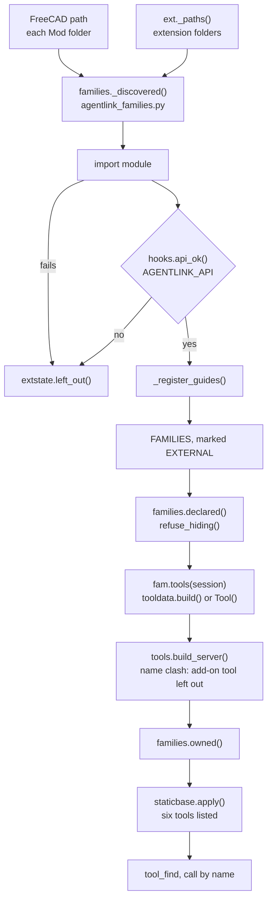

# How add-ons plug in
<!-- SPDX-License-Identifier: LGPL-2.1-or-later -->

An add-on gives the agent its own tools through the hub. The hub never names an add-on. The add-on keeps its own code and its own licence.
[docs/hooks.md](../hooks.md) is the reference for developers. This page tells the flow.

## Found by convention

1. FreeCAD puts each `Mod` folder on Python's path.
2. `families.load()` (`agentlink/families/__init__.py`) first puts the folders of extensions on the path (`ext._paths()`).
3. `_discovered()` finds each package on the path that holds `agentlink_families.py` and `__init__.py`. `AGENTLINK_EXTENSIONS` can name more modules.
4. The module is imported. A module that fails to import is left out. `extstate.left_out()` keeps the reason.
5. `hooks.api_ok()` checks the module's `AGENTLINK_API` (for example `">=1,<2"`). This hub is API 1 (`hooks.API`). A module that needs another API is left out and said.
6. `_register_guides()` registers the add-on's `freecad_guides/` (or `guides/`) folder for `guide_read`.
7. Each family in `FAMILIES` is marked `EXTERNAL`, with the module's `CREDIT` and `LICENSE`.

## The tools

A family module has `GROUP`, `INFO` and `tools(session)`. It gives its tools in one of two ways:

- **Tool data.** `hooks.tools_from_data(folder, group, handlers)` reads the add-on's `tools.json` (the format is `agentlink/tooldata.py` and `agentlink/data/tools.schema.json`). It binds each entry to a handler by name (`tooldata.build()`). Every entry needs a handler, and every handler an entry.
  - `heavy: true` puts the tool in the heavy queue (`keep.declare_heavy()`).
  - `writes: true` adds the tool to `paths.WRITERS`: its `path` is a file that it writes.
  - `pathIsCurve: true` adds it to `paths.GEOMETRIC`: its `path` is a curve, not a file.
  - `pathKeys` and `writeKeys` name the tool's other fields that hold a file it reads or writes, nested ones too: `"kicadPcb"`, `"texture.file"`, `"profiles.*"` (`*` is every value or item). `paths.declare_keys()` keeps them, and `paths.guard()` checks them before each call. A key that is not a dotted field name is left out.
  - `workbench`, `commands` and `words` go to the tool index for `tool_find` (`toolindex.declare()`).
- **Code.** `Tool(name, description, schema, fn)` from `agentlink.protocol`. The family's `HEAVY`, `WRITERS`, `GEOMETRIC`, `NOT_IN_MACROS` and `PINNED_FREE` sets say the same per family. `PATH_KEYS` and `WRITE_KEYS` (`{tool: [keys]}`) are the code form of `pathKeys` and `writeKeys`.

The guard finds the top-level `path`, `file`, `files`, `folder` and the other `paths.PATH_KEYS` fields by itself. `export` and `saveAs` are always writes. A field that the add-on does not declare is not checked: its handler calls `paths.in_file()` or `paths.out_file()`.

`tools.build_server()` adds each family's tools to the server:

- A family that fails in `tools(session)` is left out and said (`extstate.left_out()`). Agent Link still starts.
- An add-on's tool with a hub tool's name is left out. An add-on never hides or replaces a hub tool.
- `families.refuse_hiding()` refuses `REPLACES`, `HIDES`, `HIDE` and `REPLACE` on an add-on family, and takes the attribute off.
- An add-on's `GEOMETRIC`, `PINNED_FREE`, `HEAVY`, `NOT_IN_MACROS`, `PATH_KEYS` and `WRITE_KEYS` count only for the add-on's own tools (`families.owned()`).
- `tooldata.build()` leaves out what an entry with a hub tool's name declares.

## Groups

- Each family has a `GROUP`. An add-on can have its own group, or join a hub group (for example `core`). A family that joins a group that is there keeps that group's `INFO`.
- The group's `INFO` shows the add-on's `CREDIT` when the add-on gives one.
- `LEAN = True` puts the group in the lean list. An add-on's `LEAN` does not count for the hub's `core` or `find` group (`GROUP_INFO`).
- `tool_groups` shows each group in one row. `tool_groups { enable }` lists a group's tools.

## No cost when not installed

- An add-on that is not installed has no `agentlink_families` module on the path. No family loads, and no tool is added.
- The default tool list is static (`agentlink/staticbase.py`, `ToolListMode` `static`). It lists only `session_state`, `batch`, `guide_read`, `tool_find`, `approve_file` and `approve_code`.
- Every other tool, the hub's and the add-ons', is found with `tool_find` and called by name. A client that sends only listed tools uses `batch { calls }`.
- So an add-on's tools cost no tokens in the list. Its group costs one row in `tool_groups`.

## Hooks

`agentlink/hooks.py` gives add-ons more ways in. Each is optional. A hook catches and logs an add-on's error, so one add-on cannot stop FreeCAD or another add-on. Some of them:

- events: `hooks.on(event, fn)`, for example `call_done`, `after_change`, `document_closing`, `reply_written`;
- services: `hooks.provide(name, obj)` and `hooks.service(name)`;
- readers: `hooks.register_reader(kind, fn)`;
- a tab in the Agent Link panel: `hooks.register_tab(title, factory, order, workbench)`;
- a line on each answer while the add-on has work in hand: `hooks.register_rider(owner, fn)`;
- a tool that runs on the window link's socket thread: `hooks.register_thread_tool(name)`;
- more inputs on a hub tool: `hooks.extend_tool(name, properties, before, after, describe)`;
- the person's approval: `hooks.person_ok()` (see [approvals.md](approvals.md)).

## Installed at pins

The Claude extension's launcher (`packaging/mcpb/server/index.js`) installs the add-ons:

- `packaging/addons.json` lists the `sources`: repository, branch, folder, `dest` (the folder in `Mod`) and `pin`.
- Each file in `packaging/pins/` holds one commit. A pin is bumped only after the bake-off is green.
- `resolveChannel()` reads the manifest and the pins at the channel's head commit. `update()` fetches each add-on at its pinned commit and smoke-tests it.
- A source with `stdio` is also an MCP server of its own. `publishStdio()` puts the installed copy into that server's cache.
- `serverAddons` are add-ons of a stdio server. They go into that server's app folder, never into `Mod`.
- Only repositories of the project's owner are in `addons.json`.

## Third-party add-ons

A third-party add-on comes in through the person's approval:

- `addon` (`agentlink/families/unattended.py`) installs, updates or removes an add-on. It asks `approve_code` with kind `addon-install`, `addon-update` or `addon-remove`. The approval binds the commit (`git ls-remote`) or the folder's fingerprint.
- `app_extensions { action: "add" }` (`agentlink/ext.py`) adds an extension repository. It asks `approve_code` with kind `extension`.

## Flow

