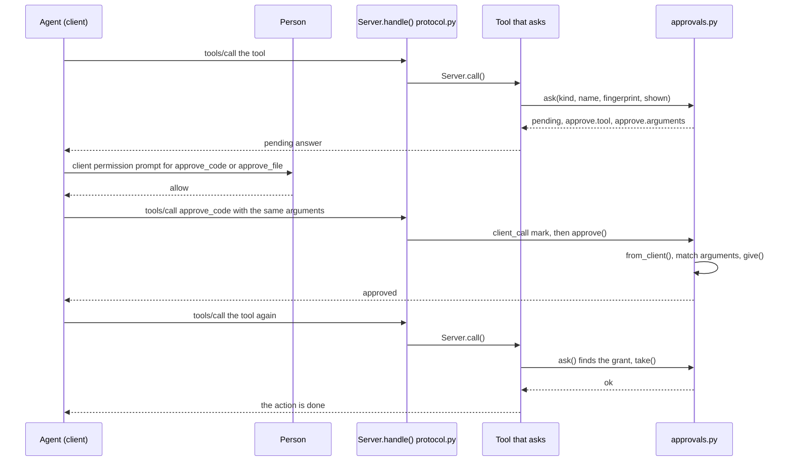

# How approvals work
<!-- SPDX-License-Identifier: LGPL-2.1-or-later -->

Some steps need the person's approval. The approval is a call of one of two small tools: `approve_file` and `approve_code`.
The person sets each tool in the client's tool permissions (in Claude Desktop: "always allow", "ask first" or "block").
With "ask first", the client asks the person before each call. So the agent cannot approve alone.
The code is `agentlink/approvals.py`.

## What asks

| What | Tool that asks | Kind | Approved with |
|---|---|---|---|
| A cookbook | `cookbook_approve` (`agentlink/cookbook.py`) | `cookbook` | `approve_code` |
| An extension repository | `app_extensions` add (`agentlink/ext.py`) | `extension` | `approve_code` |
| An add-on install, update or removal | `addon` (`agentlink/families/unattended.py`) | `addon-install`, `addon-update`, `addon-remove` | `approve_code` |
| A macro (Workshop's SafetyNet) | `macro_approve` | `macro` | `approve_code` |
| A press on a file dialog (Save, Don't Save, Replace) | `dialog_answer` (`file_dialog_approval()` in `unattended.py`) | `dialog` | `approve_file` |
| A recovered copy saved over the person's file (Workshop's SafetyNet) | `app_recover { action: "accept" }` | `recover` | `approve_file` |
| Every changed document saved at a restart | `app_restart { save: "all" }` (`agentlink/families/app.py`) | `save-all` | `approve_file` |
| A printer send with commands to look at, a print start, pause or stop (Workshop) | `printer_send`, `printer_pause`, `printer_stop` | `dialog` | `approve_file` |
| Risky G-code in an OrcaSlicer project (OrcaLink) | `orca_project` and other orca tools | `gcode` | `approve_code` (see the note below) |

`approvals.tool_for(kind)`: the kinds `dialog`, `recover` and `save-all` are `approve_file`'s (`FILE_KINDS`). Every other kind is `approve_code`'s.
`approvals.KINDS` lists the kinds that the hub takes. `arguments()` refuses any other kind.

**Note.** OrcaLink asks with kind `gcode` (`orcalink/fam_freecad.py`). At the commit of this page, `gcode` is not in `approvals.KINDS`. So in FreeCAD, that ask is refused with `invalid_input`, and the risky G-code is not written.

An add-on asks through `hooks.person_ok()`, which calls `approvals.ask()`.
A typed `confirm` is never an approval inside Agent Link. An agent can type it.

## The pending answer

`approvals.ask(kind, name, title, lines, fingerprint, on_ok, shown)`:

1. `arguments()` builds the approve tool's arguments: `kind`, `id`, `fingerprint`, `what`, and the shown fields.
2. If a grant waits for this kind, id and fingerprint, `take()` uses it up. The answer is `{ ok: true }`, and the tool acts.
3. Else the request is kept for up to an hour (`OPEN_FOR`). The answer is `pending`, with `approve: { tool, arguments }` and `next`.
4. The agent calls that approve tool with exactly those arguments.
5. The client shows the person the call and its arguments, and asks (with "ask first").
6. `approvals.approve()` checks the call and gives the approval (`give()`). It writes a line to `approvals.log` in Agent Link's home.
7. With `on_ok` (a cookbook, a macro), the approval is kept in its store, and the next call answers at once. Without it, the approval is a grant for one action, good for 10 min (`TTL`). The agent calls the first tool again with the same arguments.

The FreeCAD window can also show an Approve dialog (`agentlink/person_ok.py`). This is an optional extra path. Only a mouse release by the person, from the system, after 1.5 s in view, counts. A key press never counts.

## What is shown

The arguments are what the client shows the person. `SHOWN` sets them per tool:

- `approve_code`: `source`, `version`, `author`, `addon`, `risk`, `scan`.
- `approve_file`: `document`, `file`, `button`.

How they are made safe to show:

- `clean()` removes control characters, invisible characters and direction marks, and caps each field.
- `source_field()` shows a URL as `host: …, path: …`, with its host first. A git address `user@host:path` shows the same way. The home folder shows as `~`. A source longer than the cap is refused, because a cut would hide its end.
- For a cookbook, `risk` and `scan` come from the code scan (`agentlink/addon_scan.py`). `addon` is the fingerprint of the add-on folder that the cookbook uses.

## What binds

An approval is for one kind, one id and one fingerprint (`approvals.key()`). A new version needs a new approval.

- A cookbook or a macro: the SHA-256 of its file.
- A cookbook's add-on folder: `folder_fingerprint()`, the SHA-256 of each relative path and its bytes (`.git` and `__pycache__` left out).
- An add-on install or update from git: `commit:<sha>` from `git ls-remote`. From a folder: the folder's fingerprint.
- A file dialog, an extension, a save at restart: `identity()`, a SHA-256 of the words that name it.
- A printer action: a SHA-256 of the action, the printer's name, its address and the G-code file's SHA-256.

`approve()` refuses arguments that differ from the pending answer in any field. It refuses a fingerprint that is not the one that waits.

## What cannot approve

`protocol.Server.handle()` wraps a `tools/call` of `approve_file` or `approve_code` from the client in `approvals.client_call`.
`approve()` acts only when `from_client()` finds that call in hand.

Nested calls go through `Server.call()` only, so they never get the mark:

- a call inside a `batch`;
- a job;
- a cookbook's entries;
- a Tutor lesson (lessons also never call a tool with `approve` in its name);
- a panel button.

Each of these gets `not_allowed`, and nothing is approved.

## Sequence

