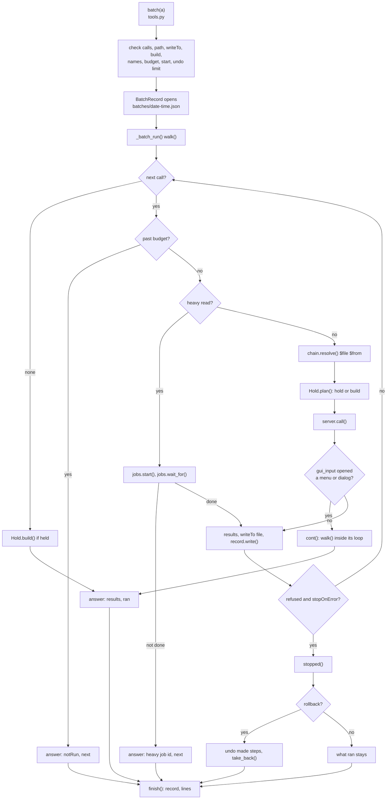

# How a batch runs
<!-- SPDX-License-Identifier: LGPL-2.1-or-later -->

`batch` runs several tools in one call, in order. It is a code tool: `batch()` and `_batch_run()` in `agentlink/tools.py` `build_server()`.
The agent's rules for it are in the batch guide (`agentlink/guides/batch.md`, `guide_read { topic: "batch" }`). This page tells how the code runs it.

## Before the first call

`batch(a)` checks the whole batch first. A fault here runs nothing.

1. A batch record or a `writeTo` file is read back by its own tool, `record_read { path, at }` (it was `batch { read, at }` until 24 Nov).
2. The calls come from `calls`, or from `path` (a JSON file, read through `paths.in_file()`, 20 MB at most).
3. Each call must be `{ tool, arguments }`. A call's `writeTo` file is checked as a write. Exact card fields beside `tool` are moved inside `arguments` (`callshape.split()`); other keys are refused (`paths.check()`).
4. `build` is checked (`hold.mode()`).
5. Every tool name must be known. An unknown name refuses the batch, with near names.
6. `budget` is 1 to 100 s (55 s by default, `BATCH_BUDGET`). `start` is the index to start at.
7. A batch never runs another batch. With `rollback`, `history_undo`, `history_redo` and `history_restore` are refused.
8. With `rollback`, the changing calls must fit in FreeCAD's undo stack (`MaxUndoSize`, 20 by default).
9. `BatchRecord` (`agentlink/batchrec.py`) opens `batches/<date>-<time>.json` in the session's folder. The newest 20 records are kept.

## Each call

`_batch_run()` runs `walk(0, False)`. For each call:

- **Budget.** Past the budget, no call starts. What ran stays (this is not a failure, so nothing is rolled back). The answer has `notRun` and `next`. The note names the calls to send in a new batch; a file batch goes on with `batch { path, start: next }`.
- **Heavy read.** A heavy read (`keep.is_heavy()` and `jobs.eligible()`) runs as a job on a worker thread (`jobs.start()`). The batch waits for it while the budget lasts (`jobs.wait_for()`). Done in time: its answer goes into the results. Not done: the batch stops with the job id (`heavy`) and `next`.
- **References.** `chain.resolve()` fills `{ "$file": … }` and `{ "$from": i, "$at": … }` just before the call runs. A `$file` is read where tools may read. `$from` takes an earlier call's answer in this part of the batch. A reference that cannot be followed refuses that call (`chain.Miss`).
- **Held build.** With `build: "end"`, `Hold.plan()` holds the recompute for `sketch_add`, `sketch_constrain`, `sketch_edit`, `sketch_offset` and `object_set` (`hold.HELD_OK`). Any other call builds first (`Hold.build()`). A held answer leaves out what only the build can read (`hold.held_answer()`).
- **The call.** `server.call()` runs it as a single call is run: guard, undo step, health, echo (see [reading-freecad.md](reading-freecad.md)).
- **Undo count.** The batch counts the undo steps that its calls made (`made`). It does not trust FreeCAD's undo count alone, because a full stack stops moving.
- **`writeTo`.** A call with `writeTo` writes its whole answer to that file (`chain.write_answer()`). Its result in the batch is only `{ written, keys | length }`.
- **Record.** `BatchRecord.write()` writes the results after each call.
- **Refusal.** A refused call with `stopOnError` (the default) stops the batch (`stopped()`).

## Rollback

`stopped()` takes the batch back when `rollback` is on (the default):

- It undoes `made` steps in the document where the batch started (`start.undo()`).
- `take_back()` removes every object the batch made that undo did not reach. They are listed in `removed`.
- The files that `writeTo` wrote stay (`writtenNote`).
- If a call closed the start document, nothing is undone (`warning`).
- If a call moved to another document, only the start document's steps are undone (`warning`).
- Inside a menu's or dialog's loop (`depth`), nothing is undone (`rollbackNote`). A dialog's command can hold an open transaction there.
- A build that leaves objects failing that were not failing before stops the batch as a refusal (`build_broke()`, `buildFailed`).

## A menu or dialog inside a batch

A `gui_input` step can open a menu or a dialog. Its own event loop then holds the GUI thread, and the batch's call is still on the stack.

1. `gui_input` sends its answer early: `gui_link.answer_now()`, then `Link.answer_now()`.
2. The call in hand is the batch, so `Link._batch_cont()` finds the batch's hook `cont()`.
3. `cont()` adds the `gui_input` answer to the results. It marks the heartbeat `working` (`gui_link.nested_work(True)`), so the watchdog does not close the menu.
4. `walk(g + 1, True)` runs the rest of the calls inside that loop. Each call starts only while the menu or dialog is still open (`gui_link.front_open()`).
5. All done: the batch's one answer goes out from inside the loop, with `nested`. `gui_link.wake()` ends the loop.
6. Closed before the end: `walk()` returns `None` at the next call. The loop ends. The rest runs at the batch's own level (`order()` skips what ran).

## The answer

`finish()` writes the final record and shapes the reply:

- `lines` and `writeTo` choose a line per call, only the refused calls, counts, or every answer in full (`batchrec.record_reply()`, `_batch_to()`).
- The reply names its `record`. When a batch's answer is lost (a dropped call, a restart), the newest record says which calls ran.
- With `build: "end"`, `builds` has the one health reading for the held calls.
- A batch past about 60 s moves to the background in the supervisor (`call-N`, see [call-flow.md](call-flow.md)).

## Flowchart

