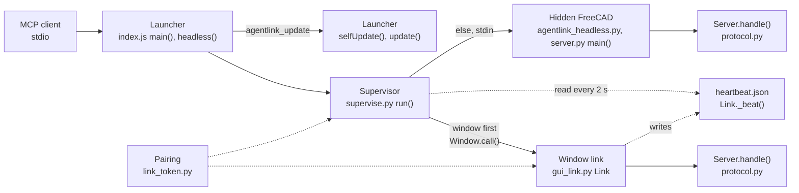
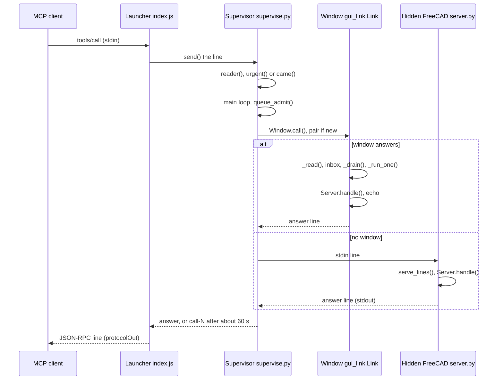

# How a call flows
<!-- SPDX-License-Identifier: LGPL-2.1-or-later -->

This page tells how one tool call goes from the MCP client to FreeCAD and back.
Each box names its module and its function. The names are from the code at the commit of this page.
For the messages themselves (`initialize`, `tools/list`, `tool_find`, `batch` and their answers), see [session.md](session.md).

## The parts

- **The client.** Claude Desktop, Claude Code or another MCP client. It starts the server and sends JSON-RPC lines on stdio.
- **The launcher.** `packaging/mcpb/server/index.js`. The Claude extension runs it with Node.
  - `main()` finds FreeCAD (`findApp()`).
  - `install()` puts the add-ons into FreeCAD's `Mod` folder. It uses the copy from the last good update, else the copy in the extension.
  - `update()` runs in the background 2 s after the start. It reads `packaging/addons.json` and the commits in `packaging/pins/` at the channel commit (`resolveChannel()`). It fetches each add-on at its pinned commit and smoke-tests it (`smokeTest()`). A version that passes serves from the next start. `agentlink_update` switches to it at once.
  - `headless()` starts FreeCAD's own Python on `agentlink_headless.py`. It sends the client's lines to that process on stdin.
  - `protocolOut()` passes only JSON-RPC lines to the client. Other output goes to `launcher.log`.
  - The launcher answers `agentlink_update` itself (`selfUpdate()`). It adds that tool to each `tools/list` answer.
- **The supervisor.** `agentlink/supervise.py`, `run()`. `agentlink_headless.py` starts it when a plain Python runs the script. It runs the hidden FreeCAD as a child process. It sends each call to the window first (`Window.call()`), else to the child.
- **The hidden FreeCAD.** `agentlink_headless.py` in the child (`AGENTLINK_SUPERVISED=1`). It runs `agentlink/server.py` `main()`: FreeCAD imported into Python, no window. The tools work on a document of their own.
- **The window link.** `agentlink/gui_link.py`, class `Link`. The **Start link** button of the Agent Link workbench starts it (`Link.start()`). It listens on `127.0.0.1:7318`. Calls run on FreeCAD's GUI thread, so the person sees each change.

## Components

## One call, step by step

1. The client writes a `tools/call` line on stdin.
2. The launcher reads the line. It sends it on to the supervisor's stdin (`send()`).
3. The supervisor's reader thread takes the line (`reader()`).
   - It answers some calls at once, on a thread of their own (`urgent()`): `job_status`, `app_open`, `app_force_restart` and `gui_unstick`. A batch that holds only one of these counts too. These calls never wait behind a held window.
   - `came()` starts the clock for the call (`sup_jobs.Jobs.came()`). `job_start { job, arguments }` becomes the call that it names.
4. The main loop checks the call.
   - A call with the same tool and arguments that hung FreeCAD two times is refused for the rest of the session.
   - A heavy tool waits for its turn (`queue_admit()`). It waits while macOS reports heat or memory pressure. It is held when the person works in the window while a heavy job runs.
5. The supervisor tries the window first (`Window.call()`).
   - `Window._open()` connects to port 7318 and pairs (`link_token.client_pair()`). Both sides prove that they know the secret in `~/.config/freecad-agentlink/link-token`. The secret never goes over the socket.
   - If the window answers, the supervisor passes the answer to the client.
   - If no window is there, the hidden FreeCAD gets the call on its stdin.
6. In the window, `Link._read()` reads the line on a socket thread. It puts the line in the inbox. A Qt timer on the GUI thread takes it (`Link._drain()`, `Link._handle_inbox()`, `Link._run_one()`).
7. `Server.handle()` runs the tool (`protocol.py`). In the window, `echo.wrap()` shows the call as it runs.
8. The answer goes back the same way. The launcher writes it to the client.
9. No answer after about 60 s: the supervisor answers with a job id `call-N` (`sup_jobs.Jobs.tick()`). The call goes on. `job_status { job: "call-N" }` gives the real answer later. The client drops a call after about 80 s, so the job answer always comes first.

## When the window is closed

- The supervisor tries to connect for each call. A closed window does not answer, so the hidden FreeCAD takes the call.
- A window that this session worked in and that went away: the next call is refused once with words that say so. What was open in the window is not in the hidden FreeCAD. The call after that goes to the hidden FreeCAD.
- After `app_restart` or `agentlink_update`, the supervisor waits for the new window (`Window._ready()`, `window_watch.Watch.wait()`). It then makes the agent's pinned document current again (`Window._back_from_restart()`).
- `app_open` starts the window in the background (`Window.open_window()`, `relaunch()` with `open -g`). It never takes the focus.
- The window died during a call (a crash, or the person quit): the call may or may not have run. The supervisor answers it `failed`. It starts FreeCAD again in the background and recovers the documents from the newest copy (`Window.recover()`). It never sends the call again.

## When the window is busy

- The GUI thread runs one call at a time. Other calls wait in the inbox.
- A call that cannot start because a menu or dialog holds the window is answered `busy` after `BUSY_AFTER` (10 s) from the socket thread (`Link._arm_busy()`, `Link._stuck()`). A call that answers the dialog may wait up to `FRONT_WAIT` (60 s).
- A tool in `hooks.THREAD_TOOLS` (`job_status` and add-on long polls) runs on the socket thread (`Link._thread_call()`). It never waits for the GUI thread.
- The watchdog (`run()`, `watchdog()`) reads the heartbeat every 2 s. A call past its deadline is stopped only when FreeCAD is truly hung: no heartbeat and no CPU work for `STALL` (60 s) (`stalled()`). A slow call is never stopped. A save in progress is never stopped.
- A hung FreeCAD is stopped by its pid (`stop_pid()`). It is started again in the background, and its documents are recovered.
- `app_force_restart` works from outside FreeCAD (`Window.force_restart()`). It stops the window whatever holds it.

## When a dialog is up

- `Link._beat()` writes `heartbeat.json` every 2 s from the GUI thread. It names the modal dialog in front (`modal_info()`) and any open menu (`popup_info()`).
- Some dialogs are pressed by rule (`keep.dialog_answer_for()`), for example FreeCAD's Document Recovery after a restart that Agent Link made.
- Inside a dialog's own event loop, only calls that answer the dialog run: `dialog_answer`, `gui_input`, `gui_unstick`, and reads that the tool declares (`_dialog_call()`). Other calls get `blocked_words()` at once.
- The supervisor answers a call that waits behind a dialog after `DIALOG_WAIT` (4 s), with the dialog's title, text and buttons (`Window.abandon()`). A call that answers the dialog gets `ANSWER_WAIT` (30 s).
- A menu (a popup) that holds a call for `POPUP_WAIT` (10 s) is closed through `gui_unstick` on a second connection (`Window.unstick()`). The call is answered `busy`. FreeCAD keeps running.
- Qt does not fire a timer again while its handler is on the stack. So a second timer (`Link._drain_nested()`) and a queued poke (`make_poster()`, `Link._poke()`) take calls inside a nested loop.

## Nested event loops

- A `gui_input` step can open a menu or dialog. That menu runs its own event loop on the GUI thread. The call that opened it is still on the stack.
- `gui_link.answer_now()` sends the call's answer before it returns. The rest of the call ends when the loop ends.
- In a batch, the calls after that `gui_input` run inside the loop (see [batch.md](batch.md)). `nested_work()` marks the heartbeat `working`, so the watchdog does not close the menu.
- A nested loop that never ends is a hang (`nested_hang()`). The watchdog starts the window again.
