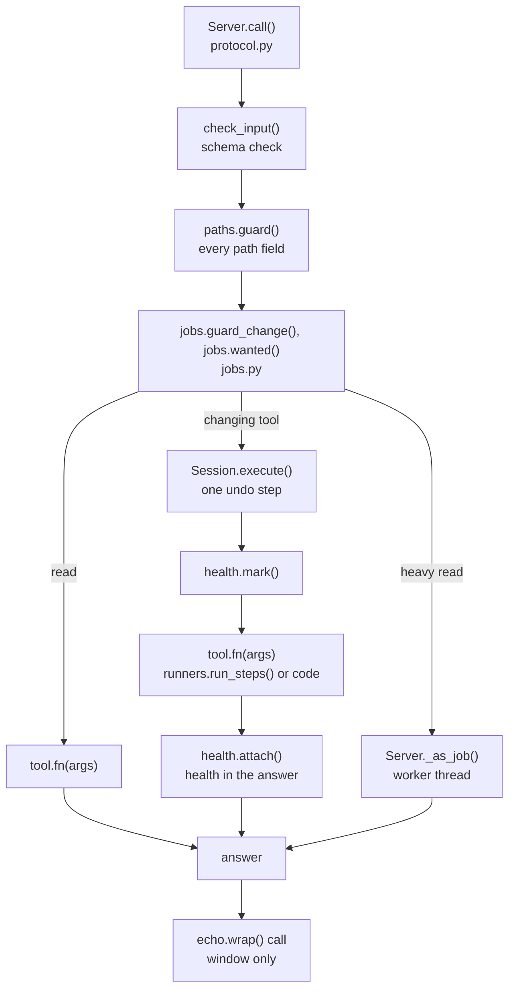

# How a tool reads FreeCAD
<!-- SPDX-License-Identifier: LGPL-2.1-or-later -->

This page tells how a tool gets to FreeCAD's data, and what it never reads.
Each box names its module and its function.

## Two kinds of tool

**Data tools.** Most of Agent Link's own tools are entries in `agentlink/data/tools.json`.
The entry is the whole tool: its description, its schema, its checks with their refusal words, its steps and its answer.
`agentlink/runners.py` runs the entry:

- `runners.tools(group, session, helpers)` makes the tools of one group. A family module calls it and gives its named helpers.
- `runners.tool()` binds an entry to its runner: `make`, `apply`, `command`, `read` or `steps`.
- `run_steps()` runs the steps in order: `let`, `refuse`, `make`, `add`, `set`, `do`, `put`, `push`, `when`, `choose`, `each`, `try`, `answer`.
- A value that starts with `=` is an expression. `agentlink/expr.py` reads it with Python's parser and walks it. It is not `eval`. `tooldata.check` refuses assignment, import, private names and f-strings when the entry loads.
- [docs/data-tools.md](../data-tools.md) has each construct, with an example.

**Code tools.** Some tools are written in code: `Tool(name, description, schema, fn)` in `agentlink/tools.py` and in `agentlink/families/*.py`.
These are the hub's own machinery (`batch`, `tool_groups`, history), window tools (`view_render`, `gui_input`, `live_run`), and tools that run one long piece of state (`app_restart`, `app_install`).

**Families.** `agentlink/families/__init__.py` `load()` imports each module in `NAMES`. Each module has `GROUP`, `INFO` and `tools(session)`.
A family whose FreeCAD module is missing (FEM, TechDraw) is left out. The log says why.
Add-on families load the same way (see [addons.md](addons.md)).

`tools.build_server()` joins the tools of every family into one `protocol.Server`.

## The path of a read

- `Server._call()` checks the arguments against the schema (`check_input()`).
- `paths.guard()` checks every path field before the tool runs (see below).
- `jobs.wanted()` sends a heavy read to a worker thread (`Server._as_job()`). While a job reads a document, `jobs.guard_change()` refuses a change to it.
- A changing tool runs inside `Session.execute()` (`agentlink/tools.py`). It opens one FreeCAD transaction, so each change is one undo step. A call that changed nothing leaves no undo step. A call that fails is taken back (`abortTransaction()`, `take_back()`).
- Every call goes through `Server.call()`. After it, add-ons hear `call_done` (`Server._done()`).

## The shared health check

`agentlink/health.py` runs round every changing call. `protocol._with_health()` calls `health.mark()` before the tool and `health.attach()` after it.
One place runs it, so a tool gets it with no code of its own. A batch's calls each carry their own.

It reads FreeCAD's own state. It takes no screenshot. It reads:

- object State flags and recompute errors: which objects failed, and FreeCAD's reason;
- the sketches that the call recomputed: degrees of freedom, conflicting, redundant and malformed constraints, open profiles;
- the shapes that the call recomputed: valid, closed, solid count, self-intersection on small shapes, overlap with other parts;
- what a family adds for its own objects (`health.register()`);
- the window: an open dialog, the task panel's warning labels, the status bar;
- `next`: one short line on what the window is in the middle of (`agentlink/nexthint.py`).

It only reads. It has a time budget (`BUDGET_S`, 1.5 s) and size limits. It names what it left unchecked. Nothing it does can fail the call.
`AGENTLINK_HEALTH=0` turns it off.

## The echo in the window

`agentlink/echo.py` shows each call in the FreeCAD window as it runs. `gui_link.Link._ready()` wraps the server with `echo.wrap()`. The hidden FreeCAD has no echo.

For each call, `Echo.before()` and `Echo.after()`:

- bring up the workbench of the tool (`WORKBENCH`, by name prefix);
- light the toolbar button that does the same job (`COMMAND`);
- select what the call works on, and then what it made;
- put a caption on the 3D view;
- add a line to the Activity tab (`agentlink/activity.py`).

Families add their own tables with `echo.declare()`: `WORKBENCHES`, `COMMANDS`, `AREAS`, `SHOWN`, `PAGES`. A family's `NO_ECHO` keeps its tools out of the echo.
The echo pauses so a person can follow (`EchoDelay`, `EchoBatchDelay`; `Echo` off for none). A failure in the echo is logged. The call goes on.

## What is read, and what is never read

`agentlink/paths.py` `guard(tool, args, out_dir)` runs before every call. It checks each top-level field in `PATH_KEYS` (`path`, `saveAs`, `file`, `files`, `folder`, `image`, `points_file` and others) and `PATH_KEYS_FOR`. A `path` of a tool in `GEOMETRIC` is a curve in the model, not a file, so it is not checked.
Then `_check_declared()` checks the fields that an add-on declares for its own tools (`DECLARED_KEYS`, nested ones too, see [addons.md](addons.md)).

Reads are an allow list (`read_refusal()`, red team 4, R4-1). A read is open in these places only:

- the session's output folder, the temporary folders, FreeCAD's own folders (`getResourceDir`, `getHomePath`, `getUserAppDataDir`, `getUserMacroDir`) and the add-on's own folder;
- the home folder, but not a hidden file or folder in it (`.zsh_history`, `.git-credentials`, `.npmrc` and all others), and not `~/Library`. Of `~/Library`, only `LIBRARY_READ` is open: `Application Support/FreeCAD`, `Application Support/OrcaSlicer`, `Application Support/BambuStudio`, `Application Support/PrusaSlicer`, `Fonts`, `Preferences/FreeCAD` and `Caches/FreeCAD`;
- outside the home, `OUTSIDE_READ`: `/Applications`, `/Volumes`, `/Users/Shared`, the font folders and `/usr/share`.

These are refused in every place, for reads and writes:

- any path through a secret part: `.ssh`, `.aws`, `.gnupg`, `.kube`, `.docker`, `.config`, `.netrc`, `.git`, `.password-store`, keychains, shell settings and `.env` (`SECRET_PARTS`). The check ignores case;
- `claude_desktop_config.json` (`NEVER_ANYWHERE`: it holds the keys of other MCP servers);
- `memory-jobs.json` and `printers.json` in Agent Link's home (`NEVER_READ`);
- `.agentlink-printers.json` in any folder (`NEVER_READ_ANYWHERE`).

A batch `$file` uses the same check. When the file is not there, the answer names the `.json` files of its folder only if the read rule opens that folder.
A glTF buffer `uri` must be a relative name in the glTF file's own folder (no absolute path, no `..`), or a `data:` URI. A buffer is 512 MB or less (`meshformats.MAX_BUFFER`).
A socket-thread tool (`hooks.register_thread_tool`) gets the same `guard()` as every other tool (R4-10).

Writes (the `path` or `file` of a tool in `WRITERS` or of a call with `action: "export"`, any `export` or `saveAs` field (`WRITE_KEYS`), or a declared write field) must also:

- be in the session's output folder, the home folder or the temporary folder;
- not be in a hidden folder outside the output folder, and not in `~/Library` outside it;
- not be Agent Link's own state (`STATE_FILES`, `STATE_DIRS`) or the store of the person's approvals and cookbooks (`cookbook.protected()`);
- not have a code extension (`NEVER_WRITE_EXT`: `.py`, `.sh`, `.app`, `.FCMacro` and others);
- not write over a FreeCAD document, except through `doc_save`.

A `name` argument must be a name, not a path.
Tools that build a path by hand use `paths.in_file()` and `paths.out_file()`. These run the same `check()`.

An add-on marks its tools with `writes`, `pathIsCurve`, `pathKeys` and `writeKeys` (see [addons.md](addons.md)). A field that is not declared is not checked by the guard. The add-on's handler then calls `paths.in_file()` or `paths.out_file()`.
