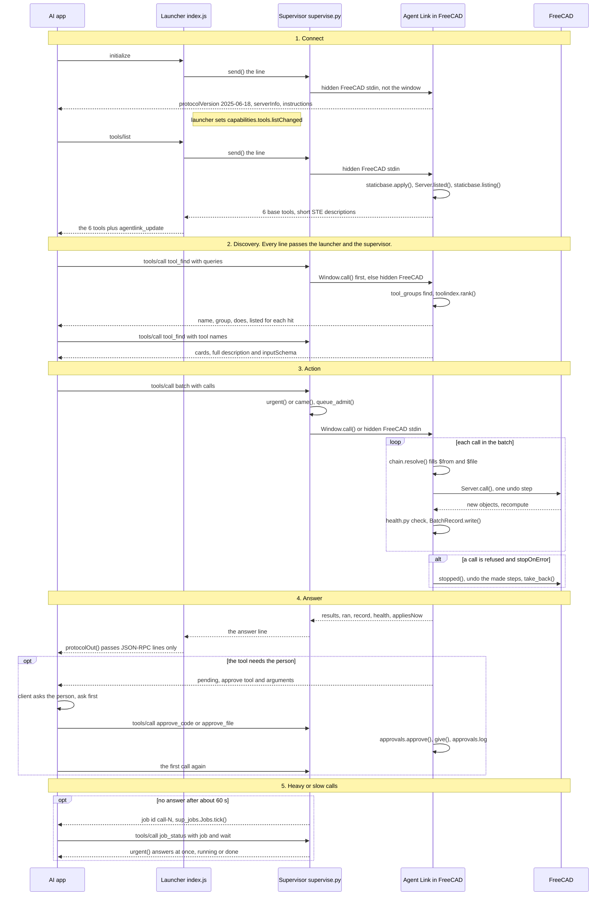

# What goes over the wire in one session
<!-- SPDX-License-Identifier: LGPL-2.1-or-later -->

This page shows the protocol view of one session: the JSON-RPC messages from the AI app to Agent Link and back.
[call-flow.md](call-flow.md) shows the parts that carry a message. This page shows what the messages hold.
Each step names its module and its function. The names are from the code at the commit of this page.
Each token number has its source. "Not measured" means that the repository has no number for it.

## The session in one diagram



## 1. Connect: `initialize` and `tools/list`

**`initialize`.**

1. The AI app starts the launcher (`packaging/mcpb/server/index.js`, `main()`). It writes `initialize` on stdin.
2. The launcher notes the id (`initing`). It sends the line to the supervisor (`send()`).
3. The supervisor sends every line that is not `tools/call` to the hidden FreeCAD (`send_child()`). Only a `tools/call` can go to the window.
4. `protocol.Server.handle()` answers: `protocolVersion` (`PROTOCOL`, `2025-06-18`), `capabilities`, `serverInfo` and `instructions`.
   - A new conversation starts again: `once.reset()` says the standing words again. `meter.new_job("initialize")` starts a new job in the usage log.
5. The launcher sets `capabilities.tools.listChanged` to true in the answer. Then it writes the answer to the app.

**`tools/list`.**

1. The launcher notes the id (`listing`). The hidden FreeCAD answers, as for `initialize`.
2. `staticbase.apply()` reads the mode. `Server.listed()` gives the tools to list. `staticbase.listing()` puts in the short descriptions.
3. `Server.note_listed()` keeps a hash of what the app now holds. `session_state` tells the agent when that list is old (`list_stale()`).
4. The launcher adds its own tool `agentlink_update` to the list. It answers that tool itself (`selfUpdate()`).

**What is in the first list.** The default mode is `static` (`agentlink/staticbase.py`, preference `ToolListMode`, or `AGENTLINK_TOOLLIST`).
It lists only the six tools in `staticbase.BASE`:

| Tool | Why it is in the base |
|---|---|
| `session_state` | What is open now, and the likely next step. |
| `batch` | Runs any tool by name, also a tool that is not listed. |
| `guide_read` | The guides: the workflow and the traps. |
| `tool_find` | Finds the other tools and gives their cards. |
| `approve_file`, `approve_code` | The person sets these two in the app's tool permissions. So the app must list them. |

The `classic` mode lists the lean groups instead: `core` and `view` (22 tools in `docs/stats/STATS.md`).
The `core` group is not the first list in the default mode.

**How the list stays small.**

- **A static list.** The base never changes by itself, so the app gets no `notifications/tools/list_changed`. Only `tool_groups { enable }` adds a group to the list (`Server.set_groups()`).
- **Short descriptions.** The style `ste` (preference `ToolDescStyle`, or `AGENTLINK_DESC`) is the default. `agentlink/data/ste.json` gives ASD-STE100 text for `batch`, `guide_read`, `session_state` and `tool_find`. The long text of `batch` is the batch guide (`guide_read { topic: "batch" }`). A refused batch names that guide (`staticbase.batch_hint()`).
- **Cards on demand.** The agent gets the description and inputs of a tool only when it asks (`tool_find { tool }`). Every tool is callable by name, listed or not.
- **Add-ons cost nothing until used.** Agent Link lists no tool of an add-on that is not installed. In static mode, an installed add-on adds no tokens until the agent turns on one of its groups.

## 2. Discovery: `tool_find`

`tool_find` is in the base. It is a front for `tool_groups` (both in `agentlink/tools.py`, `build_server()`).
Both are catalogue reads: the window answers them also while a dialog is open (`gui_link.CATALOGUE_READS`, `protocol.DIALOG_READS`).

**Find by words.** `tool_find { queries }` runs `tool_groups { find }` for each query. `toolindex.rank()` ranks the hits: the name, FreeCAD's command and workbench names, search words and the description.

```json
{"name": "tool_find", "arguments": {"queries": ["new body", "sketch rectangle", "pad"], "limit": 2}}
```

The answer, shortened. The hits come from `toolindex.rank()` over the data tools in `agentlink/data/tools.json`.
The live server also ranks the tools written in code, so its order can be a little different.

```json
{"results": [
  {"find": "new body", "tools": [
    {"tool": "pd_body_new", "group": "sketch", "does": "Make an empty PartDesign body.", "listed": false},
    {"tool": "sketch_new", "group": "sketch", "does": "Make a new sketch in a body.", "listed": false}]},
  {"find": "sketch rectangle", "tools": [
    {"tool": "sketch_add", "group": "sketch", "does": "Add geometry to a sketch, in its own x/y (mm; angles deg, counter-clockwise from +x).", "listed": false}, "…"]},
  {"find": "pad", "tools": [
    {"tool": "pd_pad", "group": "feature", "does": "Pad a closed sketch into the body, along its normal.", "listed": false},
    {"tool": "part_extrude", "group": "model", "does": "Extrude a profile into a solid.", "listed": false}]}],
 "note": "Callable by name, listed or not; tool_find { card: name } gives its whole description and inputs.",
 "ms": "…"}
```

- `does` is the first sentence of the description (`toolindex.first_sentence()`).
- `listed` tells if the app was shown the tool (`Server.is_listed()`).
- A hit that its own leading checks would refuse now comes last, with `applies: false` (`appliesnow.order()`).

**Get the cards.** `tool_find { card: ["sketch_add", "pd_pad"] }` gives each card: `tool`, `group`, `listed`, `changes`, `description` and `inputSchema`, and two example calls: `plain` (every input, a null where you give the value) and `ready` (the same call filled from the open document).
Only these two cards are loaded. The other tools of their groups are not.

**Other reads.** `tool_groups { now: true }` gives the tools that fit the state now. `tool_groups { needs, arguments }` reads a tool's own leading checks and does not run it (`agentlink/needs.py`).

## 3. Action: `run`, `batch` or `fast`

A call is one flat step: `{ "tool": "pd_pad", "sketch": "Sketch", "length": 6 }`. The tool's inputs stand beside `tool`.
For one call, the agent uses `run { ... }`. For several calls, it uses `batch { calls }`, which gives a full answer for each call.
For several calls with one short answer, it uses `fast { calls }`. `run`, `batch` and `fast` are in the base, so they also send tools that the app does not list.
In a call's inputs, `{ "$from": i, "$at": "path" }` takes a part of the answer of call `i` of the same batch (`agentlink/chain.py`).
`{ "$file": "x.json", "$at": "path" }` reads a file that an earlier call wrote with `to`.

A body, a sketch, a rectangle and a pad in one batch. The calls are those of `tests/test_batch_chain_fc.py` (`new_sketch()`, `sketch_calls()`).
The `$at` paths are the answer fields in `agentlink/data/tools.json`: `body` of `pd_body_new` and `sketch` of `sketch_new`.

```json
{"name": "batch", "arguments": {"calls": [
  {"tool": "pd_body_new", "name": "B"},
  {"tool": "sketch_new", "body": {"$from": 0, "$at": "body"}, "plane": "XY", "name": "Sk"},
  {"tool": "sketch_add", "sketch": {"$from": 1, "$at": "sketch"}, "kind": "rectangle", "center": [0, 0], "size": [40, 20]},
  {"tool": "pd_pad", "sketch": {"$from": 1, "$at": "sketch"}, "length": 5}
]}}
```

What the code does with it (details in [batch.md](batch.md)):

1. `batch()` checks the whole batch first: the tool names, `to` paths, `build`, `budget` (55 s by default) and the undo limit. A fault here runs nothing.
2. `BatchRecord` opens `batches/<date>-<time>.json` in the session's folder.
3. `_batch_run()` runs each call. `chain.resolve()` fills each `$from` just before its call.
4. `server.call()` runs each call as one undo step, with the shared health check (`protocol._with_health()`).
5. `rollback` and `stopOnError` are on by default. A refused call stops the batch, and `stopped()` undoes the steps that the batch made.
6. With `build: "end"`, the sketch calls are held and FreeCAD recomputes one time (`agentlink/hold.py`).

## 4. Answer

**The shape.** A tool's answer is one text item of compact JSON (`protocol.compact()`). A picture comes as a second item, `image/png`.

The batch above answers like this, shortened. The shape is from `_batch_run()` and `pd_common.settle()`. The volume is the value that the test expects (40 × 20 × 5 mm³).

```json
{"results": [
  {"tool": "pd_body_new", "ok": true, "result": {"body": "B", "…": "…"}},
  {"tool": "sketch_new", "ok": true, "result": {"sketch": "Sk", "body": "B", "…": "…"}},
  {"tool": "sketch_add", "ok": true, "result": {"sketch": "Sk", "added": ["…"], "state": {"…": "…"}}},
  {"tool": "pd_pad", "ok": true, "result": {"feature": "Pad", "valid": true, "volume": 4000.0, "volumeChange": 4000.0,
    "health": {"ok": true, "verdict": "nothing red"}}}],
 "ran": 4, "record": "…/batches/<date>-<time>.json", "ms": "…"}
```

**What keeps the answer short.**

- **The answer filter.** A data tool's `answer` in `agentlink/data/tools.json` names its fields. For example, `sketch_new` gives `sketch`, `body`, `on`, `offset` (only when given), `frame` and `note`. Nothing else goes out.
- **Said once.** Standing words that a tool already said in this conversation are left out and named in `saidBefore` (`once.thin_reply()`).
- **A cap.** An answer longer than `MAX_REPLY` (60,000 characters) is cut, with `truncated` (`protocol.trim()`).
- **Answers out of the conversation.** A batch call with `to` writes its whole answer to a file. Its result is only `{ written, keys }`. `batch { lines }` shortens a long batch's reply, and the record keeps every answer.

**What is added to the answer.**

- `health`: the shared health check after each changing call (`agentlink/health.py`). It has `ok`, `verdict` and short lists of what to fix: failed objects, sketch freedom, invalid or open shapes, overlaps, dialogs. It only reads, in a budget of 1.5 s (`BUDGET_S`).
- `next` in `health`: one short line of what the window is in the middle of, and the likely next tools (`agentlink/nexthint.py`, rules in `agentlink/data/nexthint.json`).
- `appliesNow`: one short line of which tools apply to the document now (`agentlink/appliesnow.py`).
- `body_check` is a tool of its own (`Session.body_check()` in `agentlink/tools.py`). It runs FreeCAD's Check Geometry and looks for slivers and very short edges. The agent calls it. It does not come with each answer.
- `notice` and add-on lines (`_add_notice()`, `_add_rider()`) come with the answer when there is something to tell.

**Refusals.** A refused call answers `{ "error": { "code", "message" } }` with `isError: true` (`Server.refusal()`).
The codes are `invalid_input`, `invalid_state`, `not_found`, `unavailable` and `failed`. The message says what to change.
An unknown tool name gets near names (`difflib`). In a batch, the refusal is in that call's row, and `stopped` gives its index.

**Approvals: the person approves, not the agent.** (Details in [approvals.md](approvals.md).)

1. A tool that needs the person answers `{ pending: true, kind, name, approve: { tool, arguments }, next }` (`approvals.ask()`).
2. The agent calls that tool (`approve_code` or `approve_file`) with exactly those arguments.
3. The app shows the call to the person and asks, when the person set the tool to "ask first".
4. `approvals.approve()` acts only on a call that came from the app (`approvals.client_call`, set in `Server.handle()`). A call inside a `batch`, a job, a cookbook or a lesson cannot approve.
5. The grant is for one kind, one id and one fingerprint. The agent calls the first tool again with the same arguments.

The kinds of `approve_file` are `dialog`, `recover` and `save-all` (`approvals.FILE_KINDS`). Every other kind is `approve_code`'s.

## 5. Where it runs

- **The supervisor** (`agentlink/supervise.py`, `run()`) sees every line. It answers `job_status`, `app_open`, `app_force_restart` and `gui_unstick` at once on a thread of their own (`urgent()`). A heavy tool waits for its turn (`queue_admit()`).
- **Window or hidden FreeCAD.** A `tools/call` goes to the window first (`Window.call()`, port 7318, paired with `link_token`). In the window, the call runs on the GUI thread, and `echo.wrap()` shows it. With no window, the hidden FreeCAD runs it. `initialize` and `tools/list` always go to the hidden FreeCAD.
- **Jobs for heavy reads.** A heavy or slow read runs on a worker thread (`agentlink/jobs.py`). The call waits up to `JOB_WAIT` (55 s). Then it answers with a job id `job-…`, and the read goes on.
- **Jobs for slow calls.** A call with no answer after `DETACH_AFTER` (60 s) gets the job id `call-N` from the supervisor (`sup_jobs.Jobs.tick()`). The call goes on. The app drops a call after about 80 s, so the job id always comes first.
- **`job_start { job, arguments }`** runs any call as a job. `wait: false` gives the id at once. `job_status { job, wait }` gives the state, and the answer when the job is done.

## Tokens for each step

The token numbers are estimates of the repository: characters divided by 3.5 (`scripts/ste_check.py`). They are not the count of the provider.

| Step | Tool or message | Typical tokens | Source |
|---|---|---:|---|
| Connect | `initialize` (server instructions) | not measured | `STATS.md` leaves the instructions out |
| Connect | `tools/list`, static mode, `ste` style (the default, 6 tools) | 1,583 | `docs/stats/STATS.md`, `scripts/stats.py` |
| Connect | `tools/list`, static mode, `full` style | 4,087 | `docs/stats/STATS.md` |
| Connect | `tools/list`, classic mode (`core` and `view`, 22 tools), `ste` / `full` | 5,937 / 8,354 | `docs/stats/STATS.md` |
| Connect | `agentlink_update`, added by the launcher | not measured | – |
| Connect | each add-on that is not installed | 0 | `docs/stats/STATS.md` |
| Connect | every hub group turned on (415 tools, `full`) | 95,983 | `docs/stats/STATS.md` |
| Discovery | `tool_find` search answer | not measured | – |
| Discovery | one card (`tool_find { tool }`): the median data tool; the largest | 190; 878 | `tests/test_needs.py` `COSTS` |
| Discovery | the cards of this example: `pd_body_new`, `sketch_new`, `sketch_add`, `pd_pad` | 120, 330, 496, 326 | `scripts/stats.py` `card()` on this commit |
| Discovery | `tool_groups` card | 729 | `tests/test_needs.py` `COSTS` |
| Discovery | one `tool_groups { needs }` answer | 42 (`fea_hold`) | `docs/data-tools.md` |
| Action | the `batch` call (its arguments) | not measured | – |
| Answer | the `batch` answer | not measured; at most 60,000 characters (`MAX_REPLY`) | `agentlink/protocol.py` |
| Answer | the pushed `appliesNow` line | 17 (sketch in edit, body with a pad) | `docs/data-tools.md` |
| Answer | `pending` approval answer, then `approve_code` / `approve_file` call | not measured | – |
| Where it runs | `job_status` answer | not measured | – |

`usage_report` gives what the calls of a real session cost, from the usage log (`agentlink/usage.py`).
